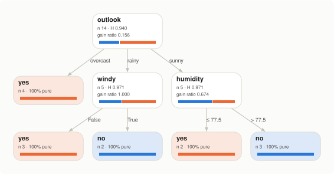
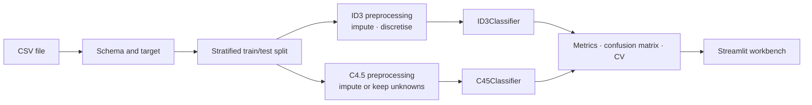
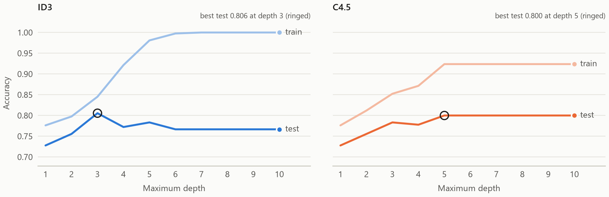
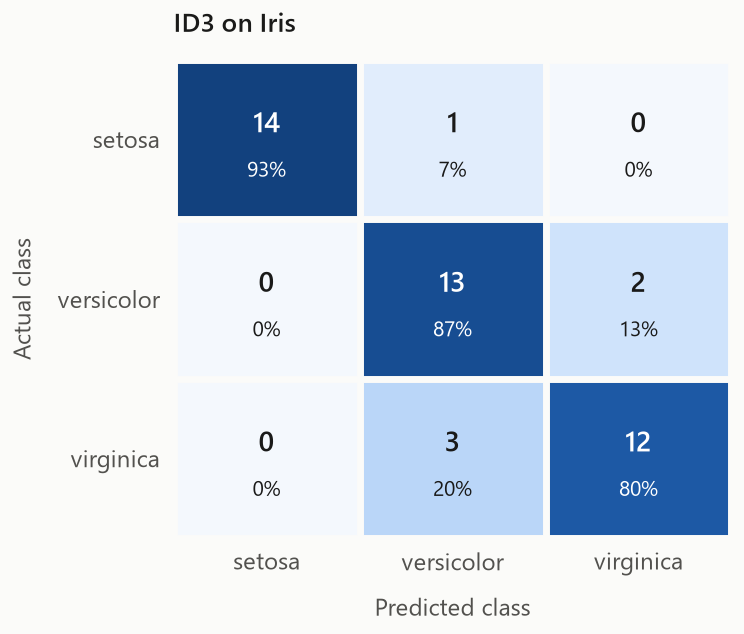
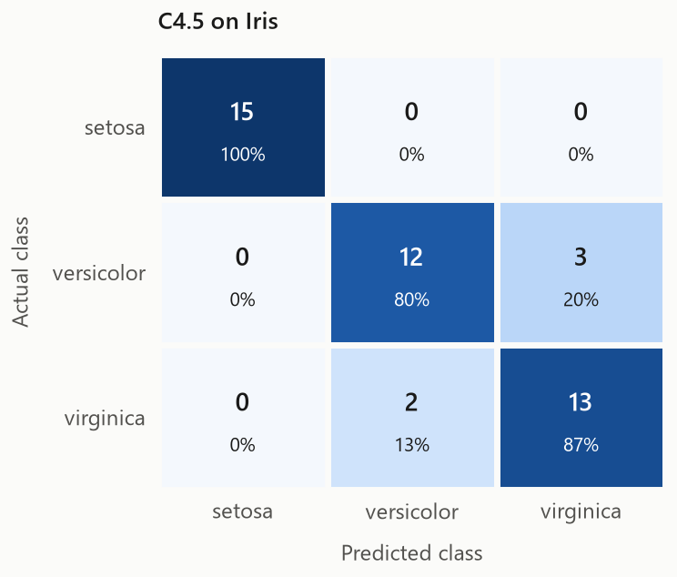

# Arbor: ID3 and C4.5 decision tree classification

Arbor is an interactive workbench for decision tree classification. Upload a CSV
(or pick a bundled dataset), choose the target attribute, decide how the data is
preprocessed, and train **ID3** and **C4.5** side by side. The app draws both
trees, shows why every split was chosen, predicts new cases, and evaluates and
compares the two algorithms with confusion matrices, accuracy, precision,
recall, F1-score, k-fold cross-validation and a depth sweep.

Both algorithms are implemented from first principles in NumPy (`arbor/`). They
are not wrappers around scikit-learn's CART. They follow scikit-learn's
estimator API, so they plug into its pipelines, cross-validation and metrics.

<p align="center">
  
  <br><sub>C4.5 on Quinlan's weather data, as drawn by the app. Leaf colour is the predicted class; the bar in each node is the class mix of its training cases.</sub>
</p>

---

## Contents

- [Features](#features)
- [Quick start (Windows)](#quick-start-windows)
- [Quick start (macOS / Linux)](#quick-start-macos--linux)
- [Using the app](#using-the-app)
- [How the algorithms are implemented](#how-the-algorithms-are-implemented)
- [Results on the bundled datasets](#results-on-the-bundled-datasets)
- [Bringing your own data](#bringing-your-own-data)
- [Project structure](#project-structure)
- [Testing](#testing)
- [Technology](#technology)
- [Limitations](#limitations)
- [Publishing to GitHub](#publishing-to-github)
- [References](#references)

## Features

| Area | What you get |
|---|---|
| **Data** | CSV upload with delimiter and encoding detection, six bundled datasets, a schema editor to include or exclude attributes and set each one to numeric or categorical, class-balance chart, majority-class baseline |
| **Preprocessing** | Missing values: impute (median/mean and mode), drop rows, or C4.5's native fractional-case handling. Duplicate removal. Discretisation of numeric attributes for ID3 (equal frequency, equal width or k-means, 2 to 10 intervals). Everything is fitted on the training split only, so no test information leaks |
| **ID3** | Information gain, multiway splits, each attribute used once per path; optional maximum depth, minimum cases to split, and minimum gain |
| **C4.5** | Gain ratio with the average-gain admission rule, binary threshold splits on continuous attributes (with Release 8's log2(cuts)/N correction), fractional cases for unknown values in both training and prediction, minimum cases per branch, error-based pruning with an adjustable confidence factor |
| **Trees** | Graphviz drawings with entropy, case counts, split scores and class-mix bars; adjustable depth and layout; a per-node *split analysis* table showing every candidate's gain, split information and gain ratio; IF-THEN rules; Weka/J48-style text output; DOT, rules and (with Graphviz installed) SVG export |
| **Evaluation** | Confusion matrix, accuracy, precision, recall and F1-score (macro or weighted), per-class report, hold-out or resubstitution scoring |
| **Comparison** | Head-to-head scorecard with an auto-generated summary, metric chart, tree size and timing, feature importance, k-fold cross-validation (3 to 10 folds, preprocessing refitted in every fold), depth-limit sweep that shows overfitting, optional scikit-learn CART reference |
| **Prediction** | Form for a new case with live answers from both trees, class probabilities and the decision path. Unknown values are allowed, which shows how C4.5 blends branches. Also a table of test-set predictions with filters and CSV download, and batch scoring of an uploaded CSV |
| **Method** | In-app explanation of entropy, information gain, gain ratio, threshold search, missing values, pruning and the metrics, with formulas |

## Quick start (Windows)

Requires **Python 3.10 or newer** ([python.org](https://www.python.org/downloads/); tick *Add python.exe to PATH* during installation).

Open **Command Prompt** in the project folder and run:

```bat
python -m venv .venv
.venv\Scripts\activate
python -m pip install --upgrade pip
pip install -r requirements.txt
streamlit run app.py
```

The app opens at <http://localhost:8501>. Stop it with `Ctrl+C`.

Next time you only need:

```bat
.venv\Scripts\activate
streamlit run app.py
```

Or double-click **`run.bat`**: it creates the virtual environment and installs the requirements on first use, then starts the app.

> **Graphviz:** trees are drawn in the browser, so the Graphviz *system* package is **not** required to use the app. Install it from <https://graphviz.org/download/> only if you want to export trees as SVG files.

## Quick start (macOS / Linux)

```bash
python3 -m venv .venv
source .venv/bin/activate
python -m pip install --upgrade pip
pip install -r requirements.txt
streamlit run app.py
```

## Using the app

The sidebar holds the experiment setup and the tabs hold the results. Every
change retrains both trees immediately; results are cached, so returning to an
earlier setting is instant.

| Sidebar section | Controls |
|---|---|
| 01 Dataset | Bundled sample or your own CSV |
| 02 Target | The class attribute to predict (suggested automatically) |
| 03 Preprocessing | Missing-value strategy, numeric fill value, ID3 intervals and binning strategy, duplicate removal |
| 04 Validation | Hold-out test set on or off, test size, stratification, random seed |
| 05 ID3 | Maximum depth, minimum cases to split, minimum information gain |
| 06 C4.5 | Maximum depth, minimum cases per branch (*m*), pruning on or off, confidence factor (CF) |

| Tab | Shows |
|---|---|
| **Data** | Dataset summary, editable schema, class balance, the preprocessing pipeline each algorithm receives, ID3's learned intervals, raw and transformed previews |
| **Trees** | The drawing, tree statistics, split analysis for any node, rules and text export |
| **Evaluation** | Metrics, confusion matrix and per-class scores for each algorithm |
| **Comparison** | Scorecard, metric chart, feature importance, cross-validation, depth sweep, optional CART reference |
| **Predict** | Single-case form with decision paths, test-set predictions, batch scoring |
| **Method** | The theory, with formulas |

[`docs/USER_GUIDE.md`](docs/USER_GUIDE.md) walks through every tab and lists experiments worth trying, such as watching pruning collapse the tree as CF drops.

## How the algorithms are implemented



Each algorithm is a scikit-learn `Pipeline` of `TreePreprocessor` followed by the
tree, because the two need different inputs: ID3 needs complete, categorical
data, while C4.5 takes raw numbers and can keep missing values. Cross-validation
refits the whole pipeline inside each fold.

| | ID3 (`arbor/id3.py`) | C4.5 (`arbor/c45.py`) |
|---|---|---|
| Split criterion | Information gain | Gain ratio among attributes with at least average gain |
| Attributes | Categorical (numbers discretised first) | Categorical and continuous |
| Split shape | One branch per value | One branch per value, or binary `A ≤ t` |
| Missing values | Imputed beforehand | Fractional cases in training and prediction |
| Pruning | None (pre-pruning limits only) | Error-based subtree replacement, CF = 0.25 by default |

The shared machinery in `arbor/tree.py` handles input encoding, recursive
growth with weighted cases, prediction by routing case weights through the
tree, and the inspection API (`rules()`, `export_text()`, `decision_path()`,
`feature_importances_`). The implementation reproduces the textbook results:
ID3 on Play Tennis gives Mitchell's tree with Gain(Outlook) = 0.2467, and C4.5
on the weather data gives the same tree as Weka's J48. Both are checked by the
test suite.

Theory, pseudocode and implementation notes are in [`docs/ALGORITHMS.md`](docs/ALGORITHMS.md);
module design is in [`docs/ARCHITECTURE.md`](docs/ARCHITECTURE.md).

## Results on the bundled datasets

Default settings: stratified 30 % hold-out with seed 42 (datasets under 30 rows
are trained and scored on all rows), median/mode imputation, 4 equal-frequency
intervals for ID3, C4.5 with *m* = 2 and CF = 0.25. Cross-validation is 5-fold
over the whole dataset, shown as mean ± standard deviation.

| Dataset | Rows | Evaluation | ID3 accuracy | C4.5 accuracy | ID3 5-fold CV | C4.5 5-fold CV | ID3 leaves | C4.5 leaves |
|---|---:|---|---:|---:|---:|---:|---:|---:|
| Play Tennis | 14 | training rows | 1.000 | 1.000 | 0.633 ± 0.415 | 0.433 ± 0.279 | 5 | 5 |
| Weather (numeric) | 14 | training rows | 1.000 | 1.000 | 0.500 ± 0.289 | 0.433 ± 0.279 | 7 | 5 |
| Iris | 150 | 30 % hold-out | 0.867 | 0.889 | 0.913 ± 0.038 | 0.953 ± 0.018 | 12 | 3 |
| Wine | 178 | 30 % hold-out | 0.870 | 0.944 | 0.916 ± 0.044 | 0.910 ± 0.067 | 21 | 5 |
| Breast Cancer (Wisconsin) | 569 | 30 % hold-out | 0.942 | 0.942 | 0.937 ± 0.024 | 0.931 ± 0.021 | 47 | 12 |
| Credit Risk (synthetic) | 600 | 30 % hold-out | 0.767 | 0.800 | 0.710 ± 0.037 | 0.810 ± 0.036 | 154 | 33 |

What the numbers say:

- **C4.5 builds much smaller trees**: about 4 to 5 times fewer leaves on the four larger datasets, at equal or better hold-out accuracy. Threshold splits use numeric attributes better than fixed intervals, and pruning removes branches that only fit noise.
- **ID3 overfits when left unrestricted.** On Credit Risk it reaches 100 % training accuracy, while its test accuracy peaks at depth 3 and then falls (below, left). C4.5's pruned tree levels off instead.
- **The 14-row datasets are for learning the mechanics, not for comparing accuracy.** Each cross-validation fold tests on 2 or 3 cases, hence the large spread.

<p align="center">
  
</p>

<p align="center">
  
  &nbsp;
  
</p>

Regenerate the figures and this table with `python scripts/make_figures.py`.

## Bringing your own data

Any classification CSV works:

- The first row holds column names; one column is the class.
- Comma, semicolon, tab and pipe delimiters are detected automatically; UTF-8 and Windows-1252 encodings are both read.
- Empty cells and `?` (the UCI convention) are read as missing.
- Columns that look like row identifiers (`id`, unique text per row) are left out by default; you can tick them back on in the schema editor.
- A target with more than 50 classes, or one that looks continuous, is rejected with an explanation, since that is a regression problem rather than classification.

## Project structure

```
.
├── app.py                    Streamlit entry point
├── arbor/                    The library: algorithms, preprocessing, evaluation, plotting
│   ├── criteria.py           Entropy, information gain, split information, gain ratio
│   ├── tree.py               Node structure and shared estimator machinery
│   ├── id3.py                ID3Classifier
│   ├── c45.py                C45Classifier, including error-based pruning
│   ├── preprocessing.py      CSV loading, profiling, TreePreprocessor
│   ├── experiment.py         Pipelines, hold-out runs, cross-validation, depth sweep
│   ├── metrics.py            Accuracy, precision, recall, F1, confusion matrix
│   ├── graph.py              Graphviz tree drawings
│   ├── charts.py             Matplotlib figures
│   ├── style.py              Colour palette shared by charts, trees and UI
│   └── datasets.py           Registry of bundled samples
├── ui/                       Streamlit interface
│   ├── sidebar.py            Experiment setup controls
│   ├── views/                One module per tab
│   ├── components.py         Header, stat strips, prediction cards
│   ├── theme.py              Stylesheet
│   └── cache.py              Cached training calls
├── data/                     Six sample datasets (CSV)
├── docs/                     User guide, algorithm notes, architecture, images
├── scripts/                  Dataset and figure generators
├── tests/                    pytest suite (53 tests)
├── .streamlit/config.toml    Theme and server settings
├── requirements.txt
├── pyproject.toml
└── run.bat                   One-click setup and launch on Windows
```

## Testing

```bat
.venv\Scripts\activate
python -m pytest
```

The suite covers the information-theoretic measures against textbook values,
the exact ID3 and C4.5 trees for the classic weather datasets, C4.5's pruning
statistics against Quinlan's published tables, fractional handling of missing
values, leakage-free preprocessing, scikit-learn compatibility (`clone`,
`cross_val_score`), the experiment pipeline, and the chart and tree renderers.

## Technology

| Requirement | How it is used |
|---|---|
| **Python** | Everything; 3.10+ |
| **NumPy** | The ID3 and C4.5 implementations: weighted contingency tables, vectorised threshold search, routing of case weights |
| **Pandas** | CSV loading, profiling, type coercion, tabular results |
| **scikit-learn** | Estimator API (`BaseEstimator`, `ClassifierMixin`, `TransformerMixin`), `Pipeline`, `train_test_split`, `StratifiedKFold`, `cross_validate`, all metrics, `KBinsDiscretizer` (k-means binning), and CART as an optional reference |
| **Matplotlib** | Confusion matrices, metric comparison, class balance, cross-validation, depth sweep and feature-importance charts |
| **Graphviz** | Tree drawings (DOT generated by `arbor/graph.py`, rendered in the browser) and SVG export |
| **Streamlit** | The interactive workbench |
| **Git / GitHub** | Version control and hosting (see below) |

## Limitations

- C4.5's *subtree raising* is not implemented; pruning only replaces subtrees with leaves.
- Thresholds are placed at the midpoint between adjacent values. C4.5 itself uses the largest training value below the midpoint; both give the same partition of the training data.
- C4.5 rule post-pruning (`c4.5rules`) and windowing are out of scope.
- Trees are drawn in the browser. Very large trees (hundreds of leaves) are best explored a few levels at a time with the *Levels shown* slider.

## Publishing to GitHub

Create an empty repository on GitHub (no README or licence), then from the project folder:

```bat
git init
git add .
git commit -m "Decision tree classification workbench: ID3 and C4.5 with Streamlit UI"
git branch -M main
git remote add origin https://github.com/<your-username>/<repository>.git
git push -u origin main
```

`.gitignore` already excludes the virtual environment and caches.

## References

1. J. R. Quinlan. *Induction of decision trees.* Machine Learning, 1(1):81–106, 1986.
2. J. R. Quinlan. *C4.5: Programs for Machine Learning.* Morgan Kaufmann, 1993.
3. J. R. Quinlan. *Improved use of continuous attributes in C4.5.* Journal of Artificial Intelligence Research, 4:77–90, 1996.
4. T. M. Mitchell. *Machine Learning*, chapter 3. McGraw-Hill, 1997.
5. Iris, Wine and Breast Cancer Wisconsin datasets: UCI Machine Learning Repository, via scikit-learn's bundled copies.

## License

MIT. See [LICENSE](LICENSE).
